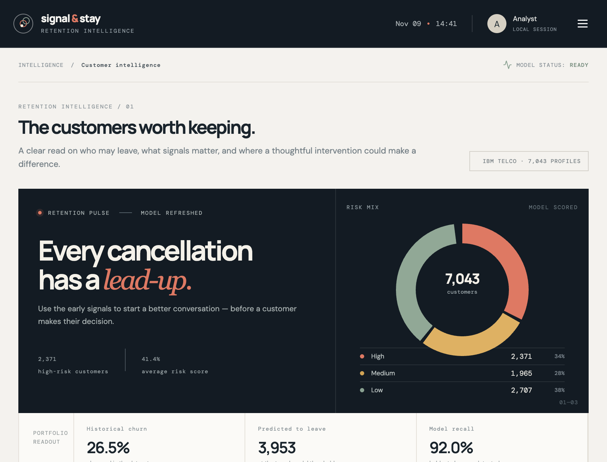
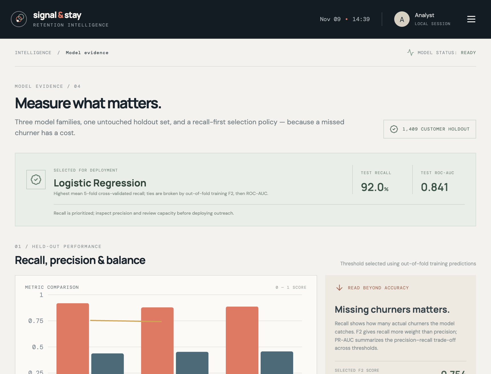
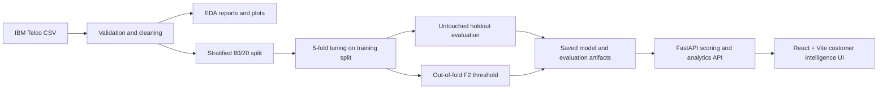

# Signal & Stay — Customer Churn Intelligence

An end-to-end customer churn intelligence workspace built around the IBM Telco Customer Churn dataset. It combines a recall-oriented model benchmark, out-of-sample risk scores, an explainable prediction API, and a responsive retention analytics interface.

> **Use responsibly:** This is a portfolio demonstration on a public, historical dataset. Churn risk is a statistical signal, not a customer's intent or a causal diagnosis. Validate recommendations with customers and controlled experiments before using them operationally.

## What is included

- **Executive overview:** portfolio churn rate, model-scored risk distribution, contract and tenure churn patterns, highest-risk customers, and holdout permutation importance.
- **Customer file:** searchable and filterable customer records, risk levels, tenure, contract, estimated churn probability, and an individual profile with directional feature effects.
- **Prediction desk:** validated input form for demographics, service choices, contract, billing, tenure, and charges; returns probability, model threshold decision, risk group, reason factors, and suggested follow-up.
- **Model evidence:** Logistic Regression, Random Forest, and XGBoost comparison; held-out metrics; ROC curves; confusion matrix; feature importance; and data quality summary.
- **Retention playbook:** high-risk cohort opportunities and cautious, testable customer-service actions.
- **EDA outputs:** churn distribution; churn by gender, contract, payment method and internet service; tenure and monthly-charge distributions; service patterns; and numeric correlations.
- **Saved artifacts:** all three tuned model pipelines, the selected all-data inference pipeline, holdout metrics, customer scores, EDA summary, and plots.

## Screenshots





## Architecture



Preprocessing is inside each scikit-learn pipeline, so imputers, scaling, and category encoders are fit only on each training fold. Hyperparameters are tuned using training data only. The test set is held out for final model comparison; it is not used to select the production model or its decision threshold.

## Run locally

### Requirements

- Python 3.9 or later
- Node.js 18 or later and npm
- Network access on the first training run to fetch the public dataset
- macOS: Homebrew `libomp` for XGBoost (`brew install libomp`)

### 1. Train and evaluate the models

From the project root:

```bash
python3 -m venv .venv
source .venv/bin/activate
python -m pip install --upgrade pip
python -m pip install -r backend/requirements.txt
cd backend
python -m app.ml.train
```

Training downloads the IBM Telco CSV into `data/raw/` if it is not already present. To use a downloaded copy instead:

```bash
cd backend
python -m app.ml.train --data ../data/raw/telco_customer_churn.csv
```

The downloader uses a commit-pinned copy of the [IBM Telco Customer Churn CSV](https://github.com/IBM/telco-customer-churn-on-icp4d/blob/d5371f5d83a446ad5673cbcca3b814b926491f8a/data/Telco-Customer-Churn.csv). If automatic download is unavailable, obtain `Telco-Customer-Churn.csv`, save it as `data/raw/telco_customer_churn.csv`, and run the command above.

The training run performs five-fold recall-oriented grid search for each algorithm, selects the model by cross-validated recall (with training out-of-fold F2 and ROC-AUC tie-breaks), tunes an F2 decision threshold from out-of-fold training probabilities, evaluates once on a stratified holdout set, then refits the selected pipeline on all available labeled records for inference.

Generated files are local and git-ignored:

| Path | Contents |
|---|---|
| `artifacts/churn_model.joblib` | Selected inference pipeline, threshold, baseline, and feature schema |
| `artifacts/models/*.joblib` | Tuned Logistic Regression, Random Forest, and XGBoost pipelines |
| `artifacts/model_performance.json` | Holdout metrics, confusion matrices, and curve coordinates |
| `artifacts/feature_importance.json` | Holdout permutation importance |
| `artifacts/scored_customers.csv` | Cross-validated/holdout risk scores for the portfolio |
| `artifacts/eda_summary.json` | EDA aggregates and data quality counts |
| `artifacts/eda/*.png` | EDA figures |

### 2. Start the API

From the project root, activate the virtual environment if needed:

```bash
cd backend
python -m uvicorn app.main:app --reload --host 127.0.0.1 --port 8000
```

API health is available at [http://127.0.0.1:8000/api/health](http://127.0.0.1:8000/api/health) and interactive OpenAPI docs at [http://127.0.0.1:8000/docs](http://127.0.0.1:8000/docs).

### 3. Start the web app

In another terminal:

```bash
cd frontend
npm install
npm run dev
```

Open the Vite URL (normally [http://localhost:5173](http://localhost:5173)). The development server proxies `/api` requests to the local FastAPI service. For a separately hosted API, set `VITE_API_URL` to its origin before building the frontend.

## API surface

| Method | Route | Purpose |
|---|---|---|
| `GET` | `/api/health` | Reports whether trained artifacts are present |
| `GET` | `/api/overview` | Portfolio KPIs, observed segment rates, and risk distribution |
| `GET` | `/api/customers` | Search, filter, sort, and paginate risk-scored records |
| `GET` | `/api/customers/{customer_id}` | Profile, local feature effects, and suggested follow-ups |
| `POST` | `/api/predict` | Validate a new profile and score it |
| `GET` | `/api/performance` | Holdout model evidence, importance, and EDA summary |
| `GET` | `/api/recommendations` | Cohort opportunities and retention hypotheses |

Risk bands shown in the interface are **Low** (<25%), **Medium** (25–<60%), and **High** (>=60%). The prediction decision is separate: it uses the F2-tuned threshold returned by the training process, so the “High” band and the model's binary alert need not be identical.

## Modeling and explainability notes

- **Data:** IBM Telco Customer Churn, a public 7,043-customer telecom dataset. `customerID` is excluded from training; duplicate rows are removed; `TotalCharges` is parsed as numeric and blank values are imputed inside the model pipeline.
- **Split and leakage control:** stratified 80/20 train/test split. `ColumnTransformer` imputers, scaling, and one-hot encoding are fit as part of each cross-validation fold.
- **Class imbalance:** class-weighted Logistic Regression and Random Forest; XGBoost uses the training-split class ratio as `scale_pos_weight`.
- **Model selection:** each algorithm receives a bounded grid search with 5-fold stratified CV scored by recall. The model winner is selected from CV results, never from test accuracy.
- **Decision policy:** the operating threshold maximizes F2 on out-of-fold training probabilities. Review precision, alert volume, and team capacity before acting on predictions.
- **Evaluation:** accuracy, precision, recall, F1, F2, ROC-AUC, average precision (PR-AUC), confusion matrix, ROC curve, and precision-recall curve.
- **Global explanation:** permutation importance measures the change in holdout ROC-AUC when one raw feature is permuted. It is not causal and can distribute importance across correlated features.
- **Individual explanation:** each entered value is compared with a training-set median/mode reference profile. The probability difference is a directional, model-based what-if—not a causal effect or additive SHAP value.

## Development checks

```bash
cd backend
python -m unittest discover -s tests -v
```

```bash
cd frontend
npm run build
```

## Project layout

```text
backend/
  app/
    main.py                 FastAPI endpoints and request validation
    service.py              Artifact loading, scoring, and analytics
    schemas.py              Prediction input constraints
    ml/
      preprocessing.py      Dataset cleaning and fold-safe transformers
      train.py              CV tuning, evaluation, thresholding, and persistence
      eda.py                EDA summary and charts
      explainability.py     Per-customer directional factor analysis
  tests/
frontend/
  src/
    components/             Customer profiles, tables, and charts
    pages/                  Overview, customer file, predictions, evidence, playbook
    api.ts                  Shared API/error handling
data/raw/                   Downloaded source data (ignored by git)
artifacts/                  Trained models, scores, and EDA (ignored by git)
```
